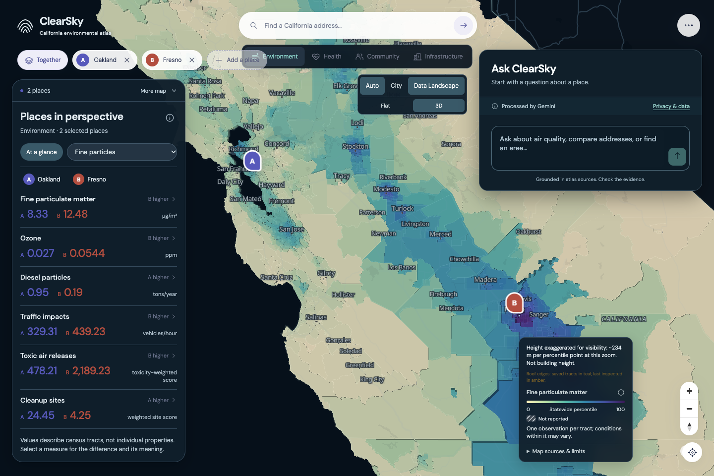
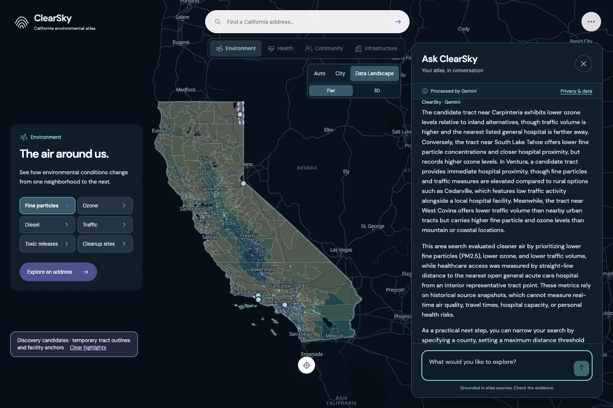
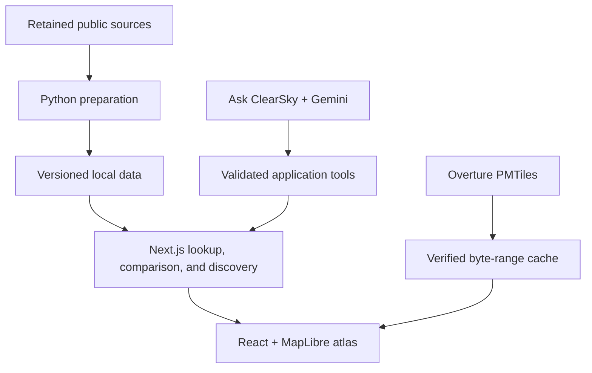

# ClearSky

### Explore. Compare. Discover.

**A California environmental atlas built for HackRPI 2026.** Compare places through environmental conditions, population health, community context, and nearby infrastructure—with the sources behind every reading.

[Get started](#run-locally) · [Ask ClearSky](#ask-clearsky) · [Data sources](#data-and-provenance) · [Architecture](#how-it-works) · [Documentation](#documentation)



_Desktop comparison of public civic example addresses in Oakland and Fresno. Map colors show the selected measure; Data Landscape heights are exaggerated for visibility._

## Why ClearSky

Understanding a place means asking several questions at once: What are the air conditions? How do nearby communities differ? Which schools and healthcare facilities are listed nearby? Those answers come from different datasets, with different dates, definitions, and geographic limits.

ClearSky brings that evidence into one map. Search for a California address, confirm the match, and compare it with other places using the same measures and scales. Ask a question in plain language to discover areas, then inspect the values, tradeoffs, and source qualifications yourself.

The current release is a **desktop MVP**. The core atlas runs without API credentials; the optional Ask ClearSky assistant uses a server-side Gemini key.

## What you can do

- **Explore 23 tract measures.** Six environmental indicators, four population-health indicators, three socioeconomic indicators, and ten age/race/ethnicity composition fields across 9,106 California census tracts.
- **Compare confirmed places.** Keep multiple addresses on the map, inspect values and compatible differences, and use the first remaining place as the comparison reference. Confirming a second place opens the comparison automatically.
- **Change perspective.** Use City for building context, Data Landscape for thematic patterns, and Auto for zoom-based transitions. Flat and 3D views distinguish physical buildings from exaggerated data heights.
- **Inspect infrastructure.** Browse source-listed public schools and licensed/certified healthcare facilities, including names, subtypes, historical status, and straight-line distances.
- **Discover areas with Ask ClearSky.** Search by supported measures, county or current map extent, thresholds, school presence, and qualified hospital/clinic proximity.
- **Inspect the evidence.** Open raw values, units, source percentiles where available, measurement periods, definitions, missing-data explanations, and source links.

## Try a comparison

1. Start the app and use the cached **Oakland** and **Fresno** examples in address search, or enter another California address.
2. Confirm each matched address. ClearSky preserves its original coordinates and resolves its tract using full-resolution boundaries.
3. Compare **Fine particles**, switch measures or domains, and open the evidence details.
4. Focus a place for its City view, or choose **Together** to frame the collection. Explore **Infrastructure** for school and healthcare context.

Two addresses in the same tract correctly share tract-level readings while retaining their own address-based facility distances.

## Ask ClearSky

Ask ClearSky turns natural-language questions into validated application queries. For example:

> Compare air quality at 125 14th St, Oakland, CA and 2600 Fresno St, Fresno, CA.
>
> Show the three tracts with the highest traffic impacts in Alameda County.
>
> Find areas with lower fine particles and ozone, with a source-listed active school.

**Gemini interprets the question and explains the findings; application code computes the results.** Local tools own spatial lookup, filtering, ranking, comparisons, and numeric evidence. For multiple criteria, discovery shows Pareto alternatives: for each returned alternative, another eligible tract cannot improve one chosen measure without worsening another. It does not combine priorities into an invented overall score.

New addresses require explicit confirmation. Discovery highlights actual tracts without inventing street addresses. Age and race/ethnicity composition remain available for neutral comparison and are excluded from discovery ranking.

The server validates tool arguments, evidence references, and map actions, with bounded calls and deadlines. Missing credentials or provider errors leave ordinary atlas exploration available. Generated explanations can still be wrong; expandable source evidence remains available for review.

<details>
<summary>See a discovery response</summary>



_A retained desktop capture from the live-provider evaluation. Findings describe historical tract evidence; hospital proximity is a straight-line source-point proxy._

</details>

See [Gemini integration](docs/GEMINI_INTEGRATION.md) and [evaluation coverage](docs/GEMINI_EVALUATION.md) for implementation details and sampled behavior.

## Run locally

### Requirements

- **Node.js 26** and npm; development environment: Node 26.10.0.
- **Python 3.14** for data preparation; development environment: Python 3.14.7.
- Internet for installation, new Census searches, basemap resources, uncached building tiles, and Gemini.
- A Gemini API key only for Ask ClearSky.

### Install and prepare

```sh
git clone https://github.com/anandenk/clearsky-atlas.git
cd clearsky-atlas
npm ci

python3 -m venv .venv
.venv/bin/python -m pip install -r scripts/requirements.txt
.venv/bin/python scripts/fetch_sources.py
.venv/bin/python scripts/prepare_data.py
.venv/bin/python scripts/cache_demo.py
.venv/bin/python scripts/write_derived_manifest.py
.venv/bin/python scripts/prepare_discovery.py

npm run dev
```

Open **<http://127.0.0.1:3000>**.

The repository includes retained source snapshots, manifests, school/healthcare inventories, and cached civic address examples. `fetch_sources.py` validates and reuses successful cached originals; missing originals are downloaded with provenance. Preparation regenerates the ignored lookup geometry, standard display geometry, observations, and discovery index. Keep the included `data/` directory.

The integrated app runs as one Next.js service. Leave `ATLAS_BACKEND_ORIGIN` unset; it belongs to the historical split frontend setup.

### Enable Ask ClearSky (optional)

If you do not already have a local configuration:

```sh
cp .env.example .env.local
```

Set `GEMINI_API_KEY` in `.env.local`. The example supplies the project's `GEMINI_MODEL` setting. Restart Next.js afterward. Keep the key server-side; `.env.local` is Git-ignored and no credential belongs in a `NEXT_PUBLIC_` variable. Provider calls consume API usage.

### Production build

After preparing the data, stop the development server before starting a production server on the same port:

```sh
npm run build
npm run start
```

The app reads local data and writes building-range caches to disk. Hosted deployment requires separate storage and runtime validation; no verified hosted deployment is included.

<details>
<summary>Additional data preparation</summary>

The bundled facility inventories are sufficient for the setup above. To reproduce them from retained sources, run these after `prepare_data.py`, then rebuild discovery:

```sh
.venv/bin/python scripts/prepare_schools.py
.venv/bin/python scripts/prepare_healthcare.py
.venv/bin/python scripts/prepare_discovery.py
```

To regenerate broad-scale overview geometry and its proof:

```sh
.venv/bin/python scripts/prepare_map_overview.py
npx --no-install prettier --write src/contracts/map-overview-proof.ts
.venv/bin/python scripts/write_derived_manifest.py
```

Restart the server after regenerating data. Overview geometry is for display; exact lookup uses unsimplified boundaries. See [backend contracts](docs/BACKEND_CHANGES.md) for `detail=overview` and verification commands.

Statewide buildings use a pinned Overture PMTiles archive through verified HTTP byte ranges with a local success cache. Full offline acquisition is optional and unfinished at this checkpoint. Platform requirements, upstream retention limits, and recovery instructions are in [BUILDINGS_STATEWIDE.md](docs/BUILDINGS_STATEWIDE.md).

</details>

## Data and provenance

| Source                                     | Included evidence                                                                 | Snapshot / scope                                                                                                    |
| ------------------------------------------ | --------------------------------------------------------------------------------- | ------------------------------------------------------------------------------------------------------------------- |
| CalEnviroScreen 5.0 final                  | Environmental, health, socioeconomic, and demographic measures                    | July 1, 2026 release; 9,106 California tracts using 2020 tract boundaries. Measurement periods differ by indicator. |
| California Department of Education         | 9,946 source-listed public schools                                                | 2025–26 inventory; historical status retained.                                                                      |
| CDPH / CHHS                                | 14,921 licensed/certified facility records; 14,919 have spatial-query coordinates | October 16, 2026 snapshot; not an inventory of every healthcare provider.                                           |
| U.S. Census Geocoder                       | Address matches and tract cross-checks                                            | Address-range interpolation; matches require confirmation.                                                          |
| Overture Maps                              | Building and building-part tiles                                                  | Release `2026-10-21.0`, within the California envelope; heights can be approximate or missing.                      |
| OpenFreeMap / OpenMapTiles / OpenStreetMap | Basemap context                                                                   | Remote map resources; attribution retained.                                                                         |

The 23 tract measures comprise:

| Domain      | Measures                                                                                                         |
| ----------- | ---------------------------------------------------------------------------------------------------------------- |
| Environment | PM2.5, ozone, diesel particles, traffic impacts, toxic air releases, cleanup-site burden                         |
| Health      | Asthma emergency visits, heart-attack emergency visits, diabetes prevalence, low birth weight                    |
| Community   | Poverty, educational attainment, housing burden, three age shares, seven publisher-defined race/ethnicity shares |

Successful downloads retain URLs, retrieval times, checksums, and validation records. Derived manifests record inputs and transformations. Nulls stay null, zero stays zero, and numerical differences require compatible definitions, units, periods, and versions. Exact lookup is separate from simplified display geometry.

See [data verification](docs/DATA_VERIFICATION.md), [facility sources](docs/FACILITY_SOURCES.md), and the [indicator registry](src/contracts/indicators.ts) for detailed contracts.

## How it works



| Part             | Implementation                                                    |
| ---------------- | ----------------------------------------------------------------- |
| Application      | Next.js 16, React 19, TypeScript, local CSS and fonts             |
| Mapping          | MapLibre GL JS, thematic tract layers, Overture buildings/parts   |
| Data preparation | Python, Shapely, pyproj, NumPy, cached source artifacts           |
| Assistant        | Google Gen AI SDK; server-side Gemini tool calling                |
| Verification     | Node test runner, Python spatial fixtures, Playwright with Chrome |

The main entry points are `app/` (pages and APIs), `src/AtlasMap.tsx` (map), `src/components/` (UI), `src/contracts/` (data semantics), `src/assistant/` (assistant tools and validation), `src/discovery.ts` (deterministic discovery), and `scripts/` (preparation and verification).

## Verification

Prepare the local data first:

```sh
npm test
.venv/bin/python scripts/test_prepare_discovery.py
npx --no-install tsc --noEmit --incremental false
```

With the app running at `:3000` and Google Chrome installed, run desktop browser checks in another terminal:

```sh
ATLAS_DESKTOP_ONLY=1 PLAYWRIGHT_BASE_URL=http://127.0.0.1:3000 npm run test:ui
```

The browser suite writes ignored screenshots under `artifacts/`. Ordinary assistant regression tests use controlled responses; they do not establish current Gemini availability. The separate live evaluation consumes provider usage:

```sh
node scripts/evaluate_assistant.mjs
```

The [publication checkpoint](docs/PUBLICATION.md) records 109 passing backend tests and an isolated dependency installation/production build. [Demo-prep records](docs/DEMO_PREP_HANDOFF.md) distinguish broad desktop and live-provider runs from later focused checks; these were incremental checks, not one final-tree acceptance run.

## Interpretation, privacy, and limits

- **Historical tract context.** Readings describe tracts and source periods, not individual homes or live conditions. The PM2.5 definition excludes specified wildfire-smoke days.
- **Comparable evidence.** A source percentile is a statewide relative position, not a concentration, percentage change, or personal disease probability. Cross-layer patterns do not establish causation.
- **Qualified infrastructure.** School status does not establish quality, catchments, or enrollment access. Healthcare proximity does not establish services, insurance acceptance, capacity, quality, or travel time. Discovery distances use an interior representative tract point; address distances use confirmed coordinates.
- **External requests.** New searches go to Census. Ask ClearSky sends submitted questions, relevant conversation context, selected addresses, and evidence to Gemini. The app does not persist search history or assistant transcripts; provider data handling is separate.
- **Partial offline operation.** Prepared tract evidence and cached examples are local. Basemap resources, new geocoding, Gemini, and uncached building ranges need upstream services.
- **Desktop scope.** Mobile and comprehensive accessibility acceptance remain open. Linked geography is an opt-in experiment at `?geography=1`.
- **Retained backlog.** Power plants need verified reporting-period and retirement-code evidence. Fire/remediation markers need suitable verified feeds. Mobile, complete offline buildings, optional stories, sharing, terrain, and voice remain in the [full product scope](docs/PRODUCT.md). Detailed gates are retained in the [readiness audit](docs/READINESS_AUDIT.md) and [integration record](docs/INTEGRATION.md).

## Documentation

| Read this                                                                                                                                          | For                                                                                                                 |
| -------------------------------------------------------------------------------------------------------------------------------------------------- | ------------------------------------------------------------------------------------------------------------------- |
| [Product scope](docs/PRODUCT.md) · [Experience](docs/EXPERIENCE.md) · [Architecture](docs/ARCHITECTURE.md) · [Build plan](docs/BUILD_PLAN.md)      | Goals, design decisions, and retained backlog                                                                       |
| [Demo-prep handoff](docs/DEMO_PREP_HANDOFF.md) · [Desktop refinements](docs/REFINEMENT_PROGRESS.md)                                                | Development continuation and performed checks; publication supersedes earlier uncommitted/private-only descriptions |
| [Address lookup](docs/ADDRESS_LOOKUP.md) · [Backend changes](docs/BACKEND_CHANGES.md)                                                              | Spatial semantics and API history                                                                                   |
| [Gemini integration](docs/GEMINI_INTEGRATION.md) · [Evaluation](docs/GEMINI_EVALUATION.md)                                                         | Assistant contracts, privacy, and sampled provider behavior                                                         |
| [Data verification](docs/DATA_VERIFICATION.md) · [Facility sources](docs/FACILITY_SOURCES.md) · [Statewide buildings](docs/BUILDINGS_STATEWIDE.md) | Source evidence and reproduction                                                                                    |
| [Publication](docs/PUBLICATION.md) · [MVP Prototype 1](docs/PROTOTYPE_1.md)                                                                        | Source publication and the preserved earlier release                                                                |

The fixed `mvp-prototype-1` tag points to application checkpoint `6dc04f3`. Its release assets preserve that earlier prototype; use the current source and setup above for the latest MVP. The [original project handoff](docs/source/california-environmental-atlas-handoff.pdf) is retained unchanged.

## Attribution and licensing

No top-level software license has been assigned. Public source availability does not grant a blanket license to the application or its datasets; preserve source-specific terms when reusing data or assets.

Building data retains **© OpenStreetMap contributors, Overture Maps Foundation**, ODbL-1.0 terms, and per-feature source credits. Basemap attribution includes OpenFreeMap, OpenMapTiles, and OpenStreetMap. Bundled MapLibre and font license texts remain in [public/maplibre](public/maplibre/LICENSE.txt) and [public/ui/fonts](public/ui/fonts/); see [asset provenance](public/ui/README.md).
